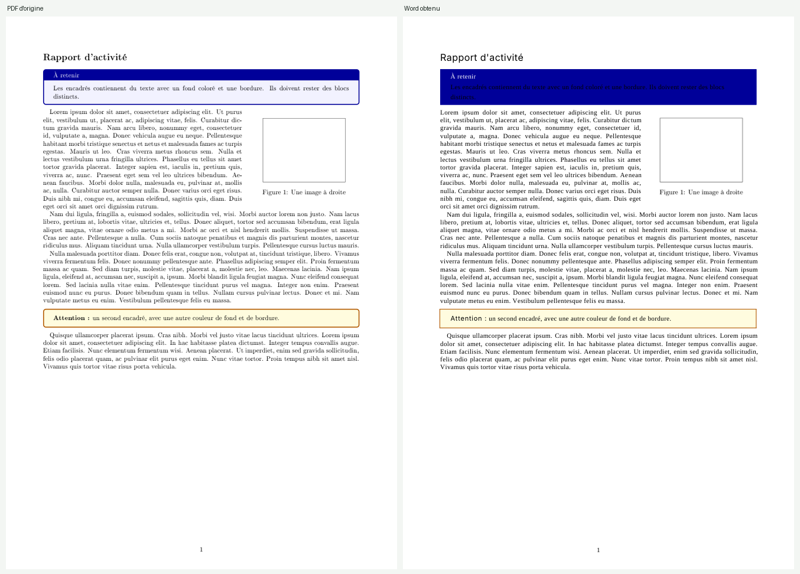

# pdf2docx

**Convertit un PDF en document Word modifiable, en gardant la mise en page.** Colonnes, tableaux (même sans bordures ni cellules fusionnées), encadrés, images avec texte autour, en-têtes et numéros de page, PDF scannés avec reconnaissance du texte (OCR). Sans Microsoft Word, tout se passe sur votre ordinateur.



_Exemple : à gauche le PDF d'origine, à droite le Word obtenu (rendu LibreOffice)._

> English: converts PDFs to editable DOCX files while keeping the layout (multi-column text, bordered or borderless tables, boxes, scans via OCR). Runs fully offline with a small local web interface or a command line. See [Install](#installation) and [Licence](#licence).

## Installation

Il faut Python 3.10 ou plus. Pour les PDF scannés, installez aussi [Tesseract](https://github.com/tesseract-ocr/tesseract) avec la langue française.

```bash
git clone https://github.com/YOUR-USER/pdf2docx.git
cd pdf2docx
python -m venv .venv
.venv\Scripts\activate            # Linux / macOS : source .venv/bin/activate
pip install .
```

Tesseract :

- **Windows** : installeur [UB-Mannheim](https://github.com/UB-Mannheim/tesseract/wiki), cochez _French_ dans les langues. Le programme le retrouve tout seul.
- **Debian / Ubuntu** : `sudo apt install tesseract-ocr tesseract-ocr-fra`
- **macOS** : `brew install tesseract tesseract-lang`

## Utilisation

**Interface web locale** (la plus simple) :

```bash
pdf2docx-gui            # ou : python -m pdf2docx      (Windows : double-clic sur lancer_interface.bat)
```

Une page s'ouvre dans le navigateur : glissez un ou plusieurs PDF, choisissez les réglages, téléchargez les `.docx`.
Le serveur n'écoute que sur `127.0.0.1` : les fichiers ne quittent pas l'ordinateur.

**Limites** (refus avant toute conversion, avec un message clair) :

| Limite                                                   | Par défaut | Changer                                   |
| -------------------------------------------------------- | ---------- | ----------------------------------------- |
| Taille d'un PDF                                          | 30 Mo      | `--max-mb 50` ou `PDF2DOCX_MAX_MB`        |
| Pages d'un PDF                                           | 60 pages   | `--max-pages 100` ou `PDF2DOCX_MAX_PAGES` |
| PDF protégé par mot de passe, corrompu, ou autre fichier | refusé     |                                           |
| Conversions en attente                                   | 10         | `PDF2DOCX_MAX_ACTIVE`                     |
| Conservation des fichiers temporaires                    | 60 min     | `PDF2DOCX_TTL_MINUTES`                    |

Une page se convertit en 1 à 3 secondes environ.

**Ligne de commande** :

```bash
pdf2docx entree.pdf sortie.docx
pdf2docx scan.pdf sortie.docx --ocr force --lang fra+eng
pdf2docx entree.pdf sortie.docx --config reglages.json
```

**Python** :

```python
from pdf2docx import Config, convert
convert("entree.pdf", "sortie.docx", Config(ocr_lang="fra+eng"))
```

## Comment ça marche

| Module           | Rôle                                                                                                 |
| ---------------- | ---------------------------------------------------------------------------------------------------- |
| `native.py`      | mots, polices, tailles, exposants ; réparation des polices sans table Unicode                        |
| `ocr.py`         | PDF scannés : redressement, OCR, tableaux à traits détectés sur l'image                              |
| `paras.py`       | lignes → paragraphes, listes, titres, en-têtes et pieds répétés                                      |
| `tables.py`      | tableaux à bordures (par cellule, fusions) et sans bordures                                          |
| `special.py`     | encadrés, figures vectorielles, formules                                                             |
| `overlay.py`     | vrais soulignements, cadres, filets et formes dessinées                                              |
| `layout.py`      | ordre de lecture, colonnes Word réelles, images flottantes                                           |
| `render.py`      | écriture du DOCX (OOXML) avec compensation d'espacement et simulation des retours à la ligne de Word |
| `gui.py`, `web/` | interface web locale, limites, sécurité                                                              |

## Mesurer la fidélité

Le banc d'essai convertit chaque PDF, relit le DOCX avec LibreOffice, puis compare à l'original : texte, position de chaque mot, rendu visuel.

```bash
pip install ".[bench]"                 # + LibreOffice installé
python bench/make_corpus.py            # régénère le corpus synthétique (LaTeX requis)
python bench/bench.py corpus/synth     # score par document
python bench/bench.py corpus/synth --tune --max-pages 2     # recherche de seuils
```

Score sur le corpus synthétique fourni (`corpus/synth`) : **0,92 en moyenne** (de 0,84 pour un scan incliné à 0,99 pour des cellules fusionnées). Sur des documents réels testés pendant le développement : de 0,74 à 0,99.

Mettez vos propres PDF dans `corpus/real/` (dossier ignoré par git) pour mesurer vos documents.

## Limites connues

- Les mesures utilisent LibreOffice comme moteur de rendu, pas Word : de petits écarts sont possibles.
- Les formules et les graphiques vectoriels sont insérés en **images** (fidèles, mais non éditables).
- Sur un scan, les polices sont approximées (Arial) et la qualité dépend de Tesseract.
- Les seuils sont calibrés sur un petit corpus : ajustez-les avec vos documents.
- GitHub Pages ne peut pas exécuter Python : la page du projet est une vitrine, le convertisseur s'installe en local.

## Développement

```bash
pip install -e ".[dev]"
ruff check .
python -m pytest -q
```

Voir [CONTRIBUTING.md](CONTRIBUTING.md) et [SECURITY.md](SECURITY.md).

## Licence

Ce projet est publié sous **GNU AGPL v3 ou ultérieure** (voir [LICENSE](LICENSE)). Il utilise [PyMuPDF](https://pymupdf.readthedocs.io/), lui-même sous AGPL v3 (ou licence commerciale d'Artifex) : tout dérivé distribué ou proposé en ligne doit rester sous AGPL et fournir son code source. Les autres dépendances (python-docx, pytesseract, OpenCV, Pillow, NumPy) ont des licences permissives.

---

© 2026 FIFALIANA Sarobidy, Madagascar · _Made with curiosity_
